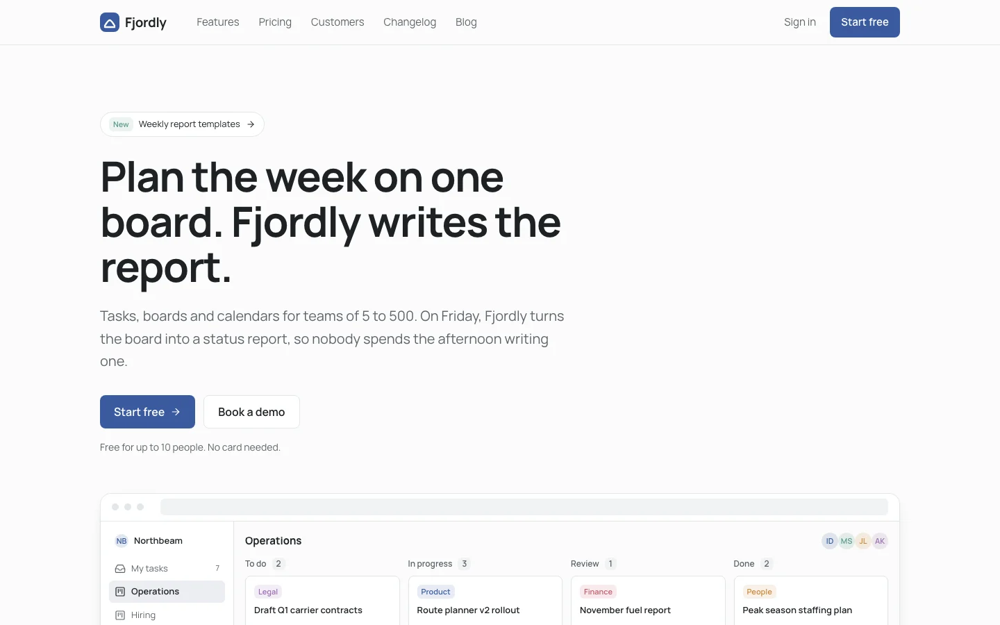
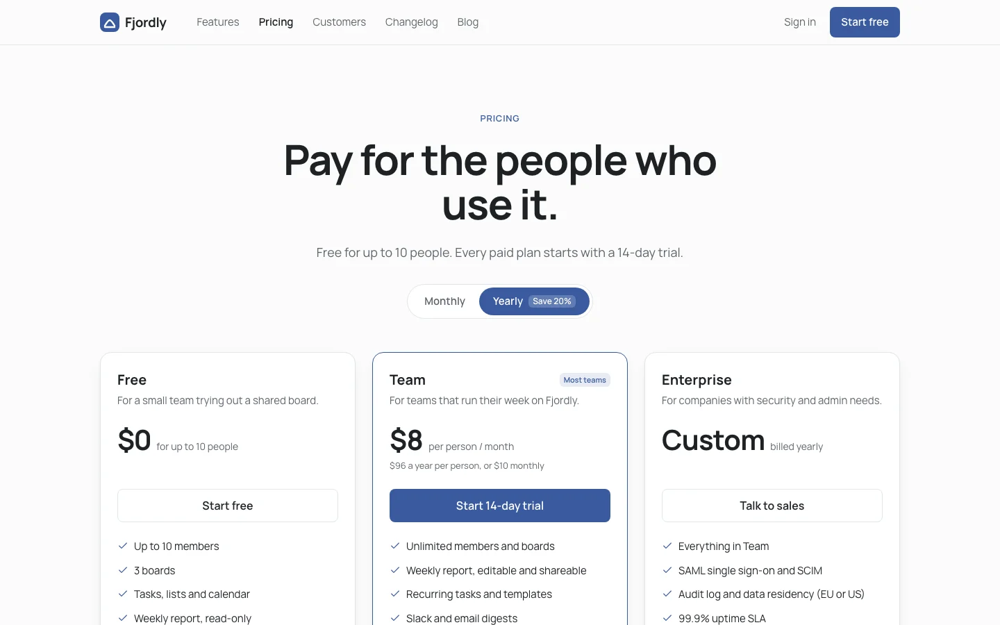
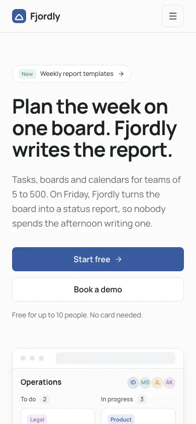

# SaaS website template

A free, complete website for a SaaS product: eight responsive pages for a sample team planning tool called Fjordly, from the home page and pricing to a customer story, changelog, blog post, sign-up and contact sales. Built on the [Nordic design system](https://codexdesign.io/design-systems/nordic). Clone it and ask Codex or Claude Code to turn it into your product's site.



 

## Pages

| # | Page | What's on it |
| --- | --- | --- |
| 1 | [Home](pages/01-home.html) | A one-line promise, a product screen drawn in HTML, key features, customer names, a testimonial, a pricing preview |
| 2 | [Features](pages/02-features.html) | Five sections (plan, do, schedule, report, stay in touch), each with a product screen |
| 3 | [Pricing](pages/03-pricing.html) | Free, Team and Enterprise, a monthly and yearly toggle, a comparison table, pricing questions |
| 4 | [Customers](pages/04-customers.html) | A full customer story with before and after numbers, plus more stories |
| 5 | [Changelog](pages/05-changelog.html) | Dated releases tagged New, Improved and Fixed |
| 6 | [Blog post](pages/06-blog-post.html) | An article with author, table of contents, headings, lists, a quote, code and related posts |
| 7 | [Sign up](pages/07-signup.html) | Google or email sign-up next to what you get and a testimonial |
| 8 | [Contact sales](pages/08-contact.html) | A demo request form with team size and needs, and questions to read before booking |

The content reads like a real product and matches across pages. Pricing is Free for up to 10 people, Team at $8 per person a month billed yearly or $10 monthly, and Enterprise on request. The customer on the home page and in the customer story is the same freight company: its Monday meeting went from 90 to 25 minutes and its weekly report from 3 hours to 20 minutes, with 42 people on 18 boards. The latest changelog entry is the feature the home page marks as new. Customer names are made up.

Each page is one HTML file, styled with Tailwind CSS v4 (loaded from a CDN) and the shared `tokens.css`. Every page works from 390 pixels wide to desktop; the phone menu uses `<details>`, so there is no JavaScript. Light is the default; add `class="dark"` to `<html>` for the dark theme. Icons are Lucide. Open any file in a browser; there is nothing to install or build.

## Use it

Copy just this template:

```bash
npx degit ummydev/ui-templates/sites/saas my-saas-site
```

Then ask your agent to make it yours:

```text
This folder is a SaaS website template. Turn it into the site for [your product], which [what it does] for [who it's for]. Keep DESIGN.md and tokens.css as the design system, replace the product screens, features, pricing, customer story and changelog with [your content], and keep prices and numbers consistent across pages. Then build it in [Next.js / Astro / your stack].
```

## Files

```text
DESIGN.md      the Nordic design system: colors, type, spacing, layout rules
tokens.css     the same tokens as CSS variables, light and dark
pages/         eight HTML pages
screenshots/   WebP screenshots at desktop and phone width, 1x and 2x
```

## Design system

Nordic is a calm design system for productivity tools: Manrope, a muted fjord blue, 12px corners and soft shadows. See it live, with a shadcn theme and the full DESIGN.md, at [codexdesign.io/design-systems/nordic](https://codexdesign.io/design-systems/nordic).

## License

MIT. Use it in personal and commercial projects.
